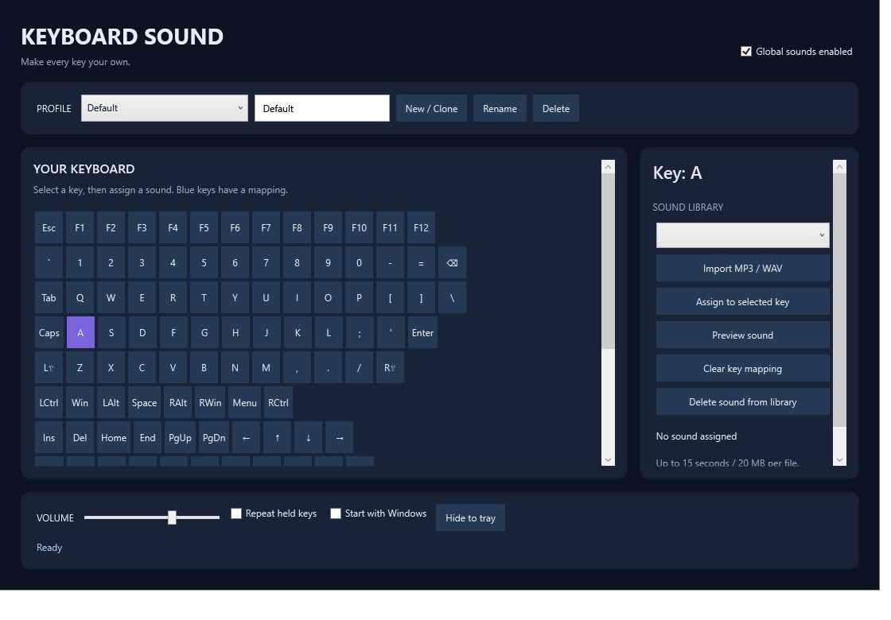

[راهنمای فارسی](README-fa.md) · [Downloads](https://github.com/mj0five/KeyboardSound/releases)
# Keyboard Sound — V1

Windows desktop keyboard sound mapper built with C#, .NET 10, WPF and NAudio 2.2.1.

## Install and use

Download `KeyboardSound-Setup-With-Icon.exe` from [Releases](https://github.com/mj0five/KeyboardSound/releases), then run it. Installation is per user, with a Start Menu shortcut, optional Desktop shortcut, and an uninstaller. The Release package includes the .NET runtime. No separate .NET installation is needed on the destination PC.

1. Open Keyboard Sound from the Start Menu.
2. Import one or more MP3/WAV sound effects.
3. Select a key on the keyboard, select a sound, and click **Assign to selected key**.
4. Type in the playground or another ordinary Windows application.
5. Use **Global sounds enabled** to pause playback and the volume slider to adjust it.
6. Type a profile name and use **New / Clone** to copy the current mapping; rename/delete and switch profiles from the top bar.
7. Closing the window hides it to the system tray. Double-click the tray icon to reopen; choose **Exit** to stop the program completely.
8. **Start with Windows** starts the installed application in the tray after sign-in.

New installations start with an empty library. Supply your own effects. Import copies files and never modifies the originals. Deleting a library sound removes its mappings in every profile after confirmation.

## Architecture

`src/KeyboardSound/` contains:

- `KeyboardHook.cs`: `WH_KEYBOARD_LL` on a dedicated STA message-loop thread. Tracks key-down/up, optionally accepts held-key repeats, ignores injected input, and always calls the next hook. No typed text or keystroke history is recorded.
- `AudioEngine.cs`: MP3/WAV decode through NAudio, mono-to-stereo conversion, resampling to 48 kHz float PCM, cached profile sounds, a persistent WaveOut output, independent overlapping sample voices, a 64-voice ceiling, clipping protection and master volume. Target buffer setting is 40 ms; measured end-to-end latency depends on the device and driver.
- `Profiles.cs`: sound metadata, independent key dictionaries per profile, JSON persistence using temporary-file replacement, corrupt-file preservation and safe library paths.
- `StartupService.cs`: current-user Windows Run registry setting.
- `MainWindow.xaml` / `.xaml.cs`: WPF keyboard selection, mapping editor, library, profiles and tray integration. The V1 UI uses event handlers; audio, native input, persistence and startup services are separate from it.
- `App.xaml` / `.xaml.cs`: styles, application lifecycle and a per-session single-instance mutex.

`tests/` is a standalone assertion runner; `installer/KeyboardSound.iss` builds the installer. `build.ps1` runs tests, publishes and packages.

## Data locations

- Settings and profiles: `%LocalAppData%\KeyboardSound\settings.json`
- Imported effects: `%LocalAppData%\KeyboardSound\Sounds\`
- Corrupt settings backup: adjacent `settings.json.corrupt-<timestamp>`
- Installed application: `%LocalAppData%\Programs\KeyboardSound\`
- Startup registration: `HKCU\Software\Microsoft\Windows\CurrentVersion\Run\KeyboardSound`

Uninstallation removes binaries, shortcuts and startup registration. Personal sounds and profiles are retained. Back up the entire data folder to preserve your library. Portable execution uses the same data folder; turn startup off before moving a portable copy.

## Build

Requirements on the build PC: Windows x64, .NET 10 SDK, internet for initial NuGet restore; Inno Setup 6.7.3 or compatible compiler for packaging.

```powershell
dotnet build src/KeyboardSound -c Release
dotnet run --project tests -c Release
dotnet run --project tests -c Release -- --integration
dotnet publish src/KeyboardSound -c Release -r win-x64 --self-contained true -o publish
& 'C:\Program Files (x86)\Inno Setup 6\ISCC.exe' installer/KeyboardSound.iss
# Or:
./build.ps1 -Dotnet dotnet -Iscc 'C:\Program Files (x86)\Inno Setup 6\ISCC.exe'
```

The installer is emitted one directory above the project folder. Distribute the installer or the **entire** `publish` folder, not just its EXE. WPF trimming is intentionally disabled. The integration tests temporarily open a window, install/dispose a native hook and open the audio device at zero volume; they use isolated test settings. They render `ui-smoke.png` in the working directory.

## Limits and validation still needed

- Installer minimum: Windows 10 build 19041; intended for Windows 10/11 x64. OS support and audio codecs depend on the Windows edition. Windows N may require Microsoft's Media Feature Pack for MP3 decoding.
- Effects must be mono/stereo, no more than 15 seconds and 20 MB each; decoded active-profile audio is capped at 256 MB. At 64 active voices new sounds are dropped.
- Keys are Windows virtual-key codes, not characters. Layout/OEM punctuation depends on the active Windows keyboard layout. Numpad Enter shares Enter's mapping; Num Lock changes some numpad virtual keys.
- Secure desktops, the sign-in screen, elevated applications and software that restricts hooks are not guaranteed. The app does not elevate itself. No key suppression or remapping occurs.
- Device switching/recovery is not automatic in V1: restart the app after changing a problematic output device. There is no numeric latency guarantee or audible validation in the automated tests.
- No signed release certificate, auto-update, profile export UI, per-key volume or language localization yet. UI is English.
- Physical typing/held-key behavior across applications, audible overlap, startup after real sign-in, DPI variations and installation on a separate clean Windows 10/11 machine remain manual acceptance checks.

## References

- [.NET self-contained publishing](https://learn.microsoft.com/en-us/dotnet/core/deploying/)
- [NAudio 2.2.1](https://www.nuget.org/packages/NAudio/2.2.1)
- [Inno Setup](https://jrsoftware.org/isinfo.php)

NAudio is MIT licensed; see `THIRD-PARTY-NOTICES.md`. Framework license files accompany the self-contained publish output.

## Preview



## Optional Fun sound pack

Download `KeyboardSound-Fun-Pack.zip` from Releases. Extract it, exit the application completely, and run `Install-Pack.cmd`. The pack includes 212 prepared WAV effects in two profiles, its mapping, a listening page, and Kenney CC0 license notices. It is optional; the application starts with an empty library.

## Validation history

The [2026-09-26 validation report](docs/VALIDATION-2026-09-26.md) records the original build and automated checks. Repository packaging and documentation changes do not imply a new cross-device acceptance test.

## Project identity and licensing

Maintained by Jey as part of the Vega project family. This publication preserves the existing application and icon; the repository banner follows the Vega identity. Third-party licenses are retained. No additional license is assigned to the original application source in this publication.
